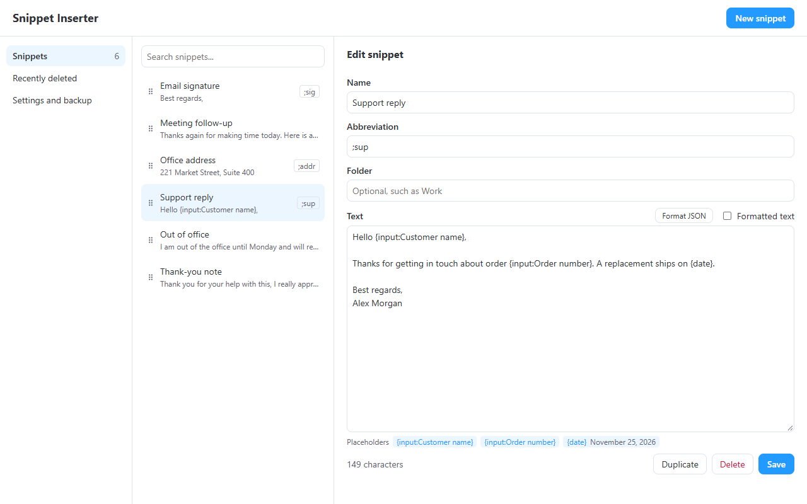

# Snippet Inserter

A browser extension for Chrome and other Chromium-based browsers that inserts saved text snippets
where you type. Double-tap Ctrl, or press Ctrl+Shift+Space, in a text box, a rich-text editor, or a
Google Docs document, pick a snippet, and it is inserted at the cursor. Snippets have no length
limit and can hold the date, the time, and fill-in fields. A snippet can also have an
abbreviation that turns into the snippet when you type it.

The panel is modeled on the snippet manager in QuillBot's browser extension, without its
1,024-character limit. This project is not affiliated with QuillBot.


## Install

Install Snippet Inserter from the
[Chrome Web Store](https://chromewebstore.google.com/detail/snippet-inserter/fbpkffddkibmmkodahmpbggoelbaieaj).

## Install from source

1. Clone this repository.
2. Open `chrome://extensions` and turn on **Developer mode**.
3. Click **Load unpacked** and select the `extension` folder.

The browser loads the extension from that folder on every start, so leave it in place. After
pulling changes, click the reload button on the extension's card. If you turn developer mode
off, Chromium disables extensions loaded this way.

## Use

To open the snippet panel, click in a text field and tap Ctrl twice quickly, or press
Ctrl+Shift+Space. You can also right-click a field and choose "Insert snippet...".

- With snippets saved, the panel lists them. Pick one with the mouse, with the arrow keys and
  Enter, or with Ctrl+2 to Ctrl+9 (Ctrl+1 is "Create new snippet").
- Type in the search box to filter. The list keeps the snippets whose name or text has a word
  that starts with what you type, or whose abbreviation starts with it. A word starts after a
  space, an apostrophe, or a hyphen, so "école" is found in "l'école". In Japanese, Chinese,
  Korean, and Thai, which have no spaces, what you type is found anywhere in the text. An accent
  typed as a separate mark matches the same letter stored as one character.
- Alt+Up and Alt+Down move the highlighted snippet up or down the list while the search box is
  empty. Ctrl+2 to Ctrl+9 insert the first 8 snippets shown, so this order decides which
  snippets get them.
- If text is selected when the panel opens, the first entry reads "Create snippet from
  selection" and the form starts with that text. Picking a snippet replaces the selection.
- The pencil on a snippet, or F2 on the highlighted snippet, opens the edit form, with Duplicate
  and Delete below it. Tab reaches both, and Delete has no shortcut of its own. After a delete,
  the list shows "Snippet deleted." with Undo, and Ctrl+Z in the list does the same.
- In a form, Ctrl+Enter saves, and Enter in the name or abbreviation field saves too. Escape goes
  back to the list, and Escape in the list closes the panel.
- To save text from any page as a snippet, select it, right-click, and choose "Save selection as
  snippet".

A space is added before the snippet when the character before the cursor is not a space or line
break. A space is added after it when the next character is not a space, line break, or
punctuation. In Google Docs no space is added. In a single-line field, a multi-line snippet goes
in as one line: each line break, with the spaces around it, becomes one space. In a rich editor,
tabs and the spaces that start a line stay as typed, so indented code keeps its indentation.

Click the extension's toolbar icon to open the snippet manager. It shows every snippet with a
large editor and drag-and-drop ordering, and keeps the last 20 deleted snippets under Recently
deleted. In its Settings and backup section you can change the trigger key to Shift or Alt or
turn it off, turn abbreviations off, and export or import snippets. The same section shows the
keyboard shortcut, with a button that opens the browser's shortcuts page to change it.



## Placeholders

Snippet text can hold placeholders, which are filled in when the snippet is inserted. The
examples are for English (United States) on 20 November 2026 at 9:14.

| Placeholder | Becomes |
| --- | --- |
| `{date}` | November 20, 2026 |
| `{date:short}` | 11/20/26 |
| `{date:iso}` | 2026-11-20 |
| `{time}` | 9:14 AM |
| `{time:iso}` | 09:14 |
| `{date+3d}` | November 23, 2026 |
| `{date-1w:iso}` | 2026-11-13 |
| `{date+1m:short}` | 12/20/26 |
| `{date+1fri}` | November 27, 2026 |
| `{time+30min}` | 9:44 AM |
| `{time-2h:iso}` | 07:14 |
| `{cursor}` | Nothing; the cursor ends here after the insert |
| `{input:Customer name}` | What you type in the fill-in form |

To count from now, write a plus or minus sign, a whole number from 0 to 999, and a unit after
`date` or `time`, before any `:short` or `:iso`. Dates take `d` for days, `w` for weeks, `m` for
months, and `y` for years; times take `min` for minutes and `h` for hours. A month or a year later
keeps the day of the month, or takes the last day of a shorter month: January 31 plus 1 month is
February 28, or February 29 in a leap year. Days and weeks count calendar days, so a
daylight-saving change never moves a date. Minutes and hours count time on the clock, so on the
night the clocks go forward an hour, `{time+1h}` at 1:30 gives 3:30. A time counted past midnight
shows only the time. A weekday, written `mon` to `sun`, counts that day: `{date+1fri}` is the first
Friday after today, `{date-1fri}` the last Friday before today, and `{date+0fri}` is today if today
is a Friday.

Dates and times use the language set on the text field or on the page. A snippet with
`{input:...}` placeholders opens a fill-in form first, with one field per label and a preview. In
the form, Enter moves to the next field and Ctrl+Enter inserts the snippet. Only these exact
forms are recognized, with lowercase units and no spaces, so `{date+3D}`, `{date + 3d}`, and other
text in braces, such as JSON, is inserted as written. The edit form lists the placeholders it finds
in the text, with what each date and time placeholder gives now, in the language of the field the
panel opened from. The snippet manager shows the same values in the browser's language. Text that
looks like a date or time placeholder but is not one, such as `{date+3x}` or `{time+30m}`, is listed
under "Not recognized, inserted as written", so a typo shows before it reaches anyone. The fill-in
form's preview uses the field's language too.

## Abbreviations

A snippet can have an abbreviation, such as `;addr`. Typing the abbreviation in a text field
replaces it with the snippet, and Ctrl+Z brings the typed text back. An abbreviation expands only
at the start of the field or after a space, punctuation, or a symbol, so `;addr` inside `x;addr`
stays as typed. With a Japanese, Chinese, or Korean input method, an abbreviation such as
`あいさつ` expands when you commit the text, not while it is still being composed.
An abbreviation has 2 to 32 characters and no spaces, and one abbreviation cannot start another,
because the shorter one would always expand first.

## Google Docs

Docs draws the document on a canvas and takes typing through a hidden frame. The extension opens
the panel at the cursor Docs draws, and inserts the snippet into that hidden frame as a paste. In
Docs, picking a snippet over a selection replaces it, "Create snippet from selection" and the
keyboard shortcut work, and one Ctrl+Z removes an insert. With other people in the document, the
panel opens at your own cursor. These things differ from other editors:

- No space is added before or after the snippet, because Docs does not expose the text next to
  the cursor.
- Docs drops spaces at the start and end of a pasted snippet.
- Each line break in the snippet starts a new paragraph.
- Abbreviations do not expand, and `{cursor}` has no effect, because the text and the cursor
  position are not in the page.

Docs has no documented interface for inserting text, so the extension relies first on how the
browser delivers focus and pastes. It uses the selectors for Docs page elements only as hints,
each with a fallback. Those selectors are in the `DOCS` constant at the top of
`extension/content.js`. If Google changes the editor, the panel still opens: at the cursor when
the extension can find it, and otherwise at your last click or at the top of the document. After
each insert the extension checks that the Docs cursor moved. If it cannot confirm the insert, it
copies the snippet to the clipboard and shows a notice asking you to press Ctrl+V. Only Docs
documents get this support, not Slides or Sheets.

## Limits

- Snippet content has no length limit. A snippet name can be up to 128 characters, and an emoji
  counts as one. A longer name is cut between whole characters.
- Single-line fields work when their type is text, search, url, or tel. Password fields are left
  alone, because a password field is not a place for a snippet. Email and number fields are left
  alone too, because they do not expose the cursor position.
- When a field's `maxlength` would cut a snippet short, nothing is inserted and a notice says
  how many characters fit. The notice counts an emoji as one character, as the snippet form does,
  while the field itself counts the way the browser does.

## Storage

Snippets are kept in `chrome.storage.local` under `snippet_manager.snippets`, as an array of
`{ createdAt, content, title, id }` records, plus `abbreviation` and `folder` when a snippet has
them. A folder name has up to 64 characters. There is no list of folders: the folders are the
names that snippets carry, so a folder exists while a snippet is in it. The array order is the
order of the list, and moving a snippet to another folder does not change its place. Deleted snippets go to `snippet_manager.deleted`, newest
first, at most 20, each with `deletedAt` and its old position. `snippet_manager.abbreviations`
holds a small `{ abbreviation: id }` copy written with every change to the list, so pages read
only that. The extension has the `unlimitedStorage` permission, so the browser's 10 MB
local-storage quota does not apply. Nothing is synced to other devices.

Export in the manager saves every snippet to `snippets-YYYY-MM-DD.json`:

```json
{
  "format": "snippet-inserter",
  "version": 1,
  "exportedAt": "2026-11-20T09:30:00.000Z",
  "snippets": [{ "createdAt": "...", "content": "...", "title": "...", "id": "..." }]
}
```

Import accepts that file, or a bare array of records. It never changes or removes a stored
snippet. It skips a record whose name and text match a stored snippet, gives a new id to a record
whose id is in use, and drops an abbreviation that is already taken. A folder that differs from
one already known only in capitals joins it, so "work" goes into "Work". A file with a higher
`version` is refused with a message to update the extension.

## Resource use

The extension adds no network traffic, timers, or caches, and nothing runs while a page is
idle. Measured in Playwright's Chromium 159 on Windows, as the median of 15 page loads:

- **Each frame of a page**: the browser itself spends about 170 KB on any extension's content
  script. This extension's own code adds about 25 to 40 KB of memory and 0.2 to 0.6 ms of
  script time when the frame loads.
- **What loads where**: every frame gets `content.js`, about 18 KB, which only watches for the
  double tap, the shortcut, the menu items, and abbreviations. `content-main.js`, about 40 KB,
  loads only in a frame where the panel opens or an abbreviation matches.
- **Storage**: a frame reads the settings and the abbreviation list at its first focus or key
  press, so frames nobody types in, such as ads, never read storage. The snippet text is read
  only when the panel opens or an abbreviation matches.
- **Each typed character**: about 7 microseconds of script, or about 14 microseconds with 50
  abbreviations stored. The abbreviation check reads at most 33 characters before the cursor,
  so the size of the field does not change it.
- **The panel** exists only while it is open, and the service worker runs only for the toolbar
  icon, the menu items, and the shortcut.

## Project layout

```
extension/            The extension itself; this is the folder to load.
  manifest.json
  content.js          Runs in every frame: the double tap, the shortcut and menu messages, and
                      typed abbreviations.
  content-main.js     Loaded when a frame needs it: places the panel and inserts the snippet.
  panel.html/.css/.js The snippet panel, shown in an extension iframe.
  options.html/.css/.js
                      The snippet manager, opened from the toolbar icon.
  background.js       The right-click menu items and the keyboard shortcut.
  lib/
    snippets.js       Storage, import and export, abbreviation rules.
    placeholders.js   {date}, {time}, {cursor}, and {input:Label}.
  icons/
tests/
  e2e/                Playwright end-to-end tests and their fixtures.
  unit/               Node unit tests for extension/lib.
  live/               The check against the real Google Docs editor.
  pages/              Test pages served to the browser during the tests.
scripts/
  make-icons.py       Redraws extension/icons.
docs/screenshots/     Screenshots used in this README.
playwright.config.js        Configuration for npm test.
playwright.live.config.js   Configuration for npm run test:docs-live.
package.json
```

## Tests

The end-to-end tests load the extension into Playwright's Chromium and drive real pages.

```
npm install
npm run browsers      # once: downloads Playwright's Chromium build
npm test              # headless run
npm run test:headed   # watch the browser
npm run test:report   # open the HTML report of the last run
npm run test:unit     # Node unit tests for extension/lib, no browser
```

Playwright cannot open the browser's own right-click menu or press an extension command, so the
menu and shortcut tests call the service worker's handlers, which it exposes as
`self.snippetInserter`. The real menu and shortcut call the same functions.

`tests/pages/docs.html` stands in for the Google Docs editor in `npm test`, and its query
parameters imitate changes Google could make, such as a renamed input frame or a missing cursor.
To check the real editor, set `DOCS_TEST_URL` to a Google Doc that anyone with the link can edit
and run `npm run test:docs-live`. The check replaces the document's text, so use a scratch
document. If it fails while `npm test` passes, the failure message says which part of the live
editor no longer matches the stand-in.

`playwright.config.js` runs the tests fully in parallel on 4 worker processes (2 when the `CI`
environment variable is set) and retries a failed test up to 2 times. Retries use Playwright's
`isolated` strategy: they wait until the rest of the suite has finished, then run one at a time
in a single worker. A test that failed only because the other workers loaded the machine then
runs without that load. The first retry records a trace. Each test gets its own browser profile,
so tests share no stored snippets or settings and can run in any order. To check for intermittent
failures, repeat the suite with `npx playwright test --repeat-each=3`.

To test another copy of the extension, such as an unzipped release package, point the
`EXTENSION_PATH` environment variable at its folder before running `npm test`.

In a test, send a key that closes the panel with the `pressInPanel` helper, not with
`page.keyboard`. The panel iframe is removed on keydown, and `page.keyboard` would then wait for
a keyup that can no longer reach it.

## Contributing

Report bugs and suggest features in
[issues](https://github.com/CommitMaster102/snippet-inserter/issues).
[CONTRIBUTING.md](CONTRIBUTING.md) says how to build and test a change, and everyone taking part
follows the [code of conduct](CODE_OF_CONDUCT.md). Report a security problem privately, as
[SECURITY.md](SECURITY.md) describes.

## Support the project

Snippet Inserter is free, and every feature works without paying. If you want to support its
development, you can donate on [Ko-fi](https://ko-fi.com/commitmaster102).

## License

MIT. See [LICENSE](LICENSE).
