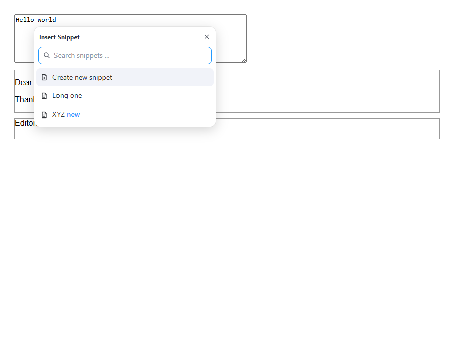

# Snippet Inserter

A browser extension for Chrome and other Chromium-based browsers that inserts saved text snippets
where you type. Double-tap Ctrl in a text box or a rich-text editor, pick a snippet, and it is
inserted at the cursor. Snippets have no length limit.

The panel is modeled on the snippet manager in QuillBot's browser extension, without its
1,024-character limit. This project is not affiliated with QuillBot.



## Project layout

```
extension/            The extension itself; this is the folder to load.
  manifest.json
  content.js          Detects the double tap, places the panel, inserts the snippet.
  panel.html/.css/.js The snippet panel, shown in an extension iframe.
  options.html/.js    Settings page (which key opens the panel).
  background.js       Opens the settings page from the toolbar icon.
  icons/
tests/
  e2e/                Playwright end-to-end tests and their fixtures.
  pages/              Test page served to the browser during the tests.
scripts/
  make-icons.py       Redraws extension/icons.
docs/screenshots/     Screenshots used in this README.
playwright.config.js
package.json
```

## Install from source

1. Clone this repository.
2. Open `chrome://extensions` and turn on **Developer mode**.
3. Click **Load unpacked** and select the `extension` folder.

The browser loads the extension from that folder on every start, so leave it in place. After
pulling changes, click the reload button on the extension's card. Chromium disables extensions
loaded this way while developer mode is off.

## Use

Click in a textarea or rich-text editor and tap Ctrl twice quickly.

- With snippets saved, the panel lists them. Pick one with the mouse, with the arrow keys and
  Enter, or with Ctrl+2 to Ctrl+9 (Ctrl+1 is "Create new snippet").
- Type in the search box to filter. Filtering starts at three characters, after a half-second
  pause, and matches words that start with the query in the name or the text.
- If text is selected when the panel opens, the first entry reads "Create snippet from
  selection" and the form starts with that text. Picking a snippet replaces the selection.
- The pencil on a snippet opens the edit form, which also has "Delete snippet" (Ctrl+1).
- In a form, Ctrl+Enter saves, and Enter in the name field saves too. Escape goes back to the
  list, and Escape in the list closes the panel.

The snippet gets a leading space when the character before the caret is not a space or line
break, and a trailing space when the character after it is not a space, line break, or
punctuation.

The trigger key can be changed to Shift or Alt, or turned off, from the extension's options page
(click its toolbar icon).

## Limits

- Snippet content has no length limit. A snippet name can be up to 128 characters.
- Single-line inputs (`<input type="text">`) are not supported, only textareas and rich-text
  editors.
- Google Docs is not supported.

## Storage

Snippets are kept in `chrome.storage.local` under `snippet_manager.snippets`, as an array of
`{ createdAt, content, title, id }` records. The extension has the `unlimitedStorage` permission,
so the browser's 10 MB local-storage quota does not apply. Nothing is synced or sent over the
network.

## Tests

The end-to-end tests load the extension into Playwright's Chromium and drive real pages.

```
npm install
npm run browsers      # once: downloads Playwright's Chromium build
npm test              # headless run
npm run test:headed   # watch the browser
npm run test:report   # open the HTML report of the last run
```

`playwright.config.js` runs the tests fully in parallel on 4 worker processes (2 when the `CI`
environment variable is set) and retries a failed test up to 2 times. Retries use Playwright's
`isolated` strategy: they wait until the rest of the suite has finished and then run one at a
time in a single worker, so a failure caused by load from the other workers is retried without
that load. The first retry records a trace. Each test gets its own browser profile, so tests
share no stored snippets or settings and can run in any order. To check for intermittent
failures, repeat the suite with `npx playwright test --repeat-each=3`.

To test another copy of the extension, such as an unzipped release package, point the
`EXTENSION_PATH` environment variable at its folder before running `npm test`.

Keys that close the panel are dispatched inside the panel document by the `pressInPanel` helper
instead of being pressed with `page.keyboard`. The panel iframe is removed on keydown, and
Playwright waits for the matching keyup to reach a frame that no longer exists.

## License

MIT. See [LICENSE](LICENSE).
