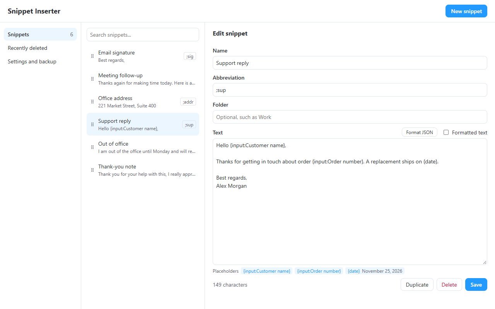

# User guide

This guide describes every feature of Snippet Inserter. To install it, see the
[README](../README.md#install).

## Use

To open the snippet panel, click in a text field and tap Ctrl twice quickly, or press
Ctrl+Shift+Space. You can also right-click a field and choose "Insert snippet...". On a Mac, press
Cmd wherever this guide names Ctrl in a shortcut, as in Cmd+Shift+Space or Cmd+2; the double tap
uses the Control key.

- With snippets saved, the panel lists them. Pick one with the mouse, with the arrow keys and
  Enter, or with Ctrl+2 to Ctrl+9 (Ctrl+1 is "Create new snippet"). The Ctrl shortcuts in the
  panel and the manager (Ctrl+1 to Ctrl+9, Ctrl+Z, Ctrl+S, Ctrl+K) work on any keyboard layout, such
  as French AZERTY or Russian, because they use the Latin letter or digit printed on the key, or the
  key's position when it prints another alphabet or a symbol.
- Type in the search box to filter. The list keeps the snippets whose name, text, or folder has a
  word that starts with what you type, or whose abbreviation starts with it. A word starts after a
  space, an apostrophe, or a hyphen, so "école" is found in "l'école". In Japanese, Chinese, and
  Thai, which are written without spaces between words, what you type is found anywhere in the text.
  Korean has spaces between words, so in Korean what you type is found at the start of a word, as in
  English. An accent typed as a separate mark matches the same letter stored as one character.
- Alt+Up and Alt+Down move the highlighted snippet up or down the list while the search box is
  empty. Ctrl+2 to Ctrl+9 insert the first 8 snippets shown, so this order decides which
  snippets get them. Under a folder, the snippet moves past the next snippet of the same folder,
  which also moves it past the snippets of other folders between them.
- A snippet can have one folder, typed in the Folder field of the form; the field suggests the
  folders you already use. Once a snippet has a folder, a row of buttons appears under the search
  box: All, each folder, and No folder. Click one, or press Tab from the search box and use the
  Left and Right arrows, to list only that folder's snippets. Enter, Space, or Down goes back to
  the search box. Ctrl+2 to Ctrl+9 number the snippets shown, and a new snippet made under a
  folder starts in it. The panel always opens on All. A folder exists while a snippet is in it, so
  you make one by typing its name in a snippet, and it disappears with its last snippet.
- If text is selected when the panel opens, the first entry reads "Create snippet from
  selection" and the form starts with that text. Picking a snippet replaces the selection.
- The pencil on a snippet, or F2 on the highlighted snippet, opens the edit form, with Duplicate
  and Delete below it. Tab reaches both, and Delete has no shortcut of its own. After a delete,
  the list shows "Snippet deleted." with Undo, and Ctrl+Z in the list does the same.
- In a form, Ctrl+Enter saves, and Enter in the name or abbreviation field saves too. Enter in the
  folder field does not, because it may be picking a suggestion from that field's list. Escape
  goes back to the list, and Escape in the list closes the panel.
- A screen reader announces an error under a field of the panel or the manager when it appears,
  such as a name longer than 128 characters or an abbreviation already in use. While the error
  shows, it describes its field, and the field is marked invalid.
- To save text from any page as a snippet, select it, right-click, and choose "Save selection as
  snippet".

A space is added before the snippet when the character before the cursor is not a space or line
break. A space is added after it when the next character is not a space, line break, or
punctuation. In Google Docs no space is added. In a single-line field, a multi-line snippet goes
in as one line: each line break, with the spaces around it, becomes one space. In a rich editor,
tabs and the spaces that start a line stay as typed, so indented code keeps its indentation.

Click the extension's toolbar icon to open the snippet manager. It shows every snippet with a large
editor and drag-and-drop ordering, and keeps the last 20 deleted snippets under Recently deleted.
Under the search box, a button for each folder shows how many snippets it holds. Drag a row onto a
button to move that snippet into the folder, or onto No folder to take it out; it keeps its place in
the list. With a folder selected, Rename folder renames it on every snippet, and joins it to another
folder if you type that folder's name. Remove folder, which asks for a second click, takes the
snippets out of the folder and keeps them. In its Settings and backup section you can change the
trigger key to Shift or Alt or turn it off, choose when abbreviations expand or turn them off, list
the sites where the double tap and abbreviations are off, and export or import snippets. The same
section shows the keyboard shortcut, with a button that opens the browser's shortcuts page to change
it.

## Turning sites off

To stop the double tap and abbreviations on a site, click the round button with a slash next to
Close at the top of the snippet panel. It is hidden in the forms, and on a page whose address the
browser does not tell the panel, such as a local file. The panel closes and a notice names the site.
You can also add a site under "Sites where the double tap and abbreviations are off" in the
manager's Settings, by typing a host name or pasting an address: `https://mail.example.com/inbox` is
saved as `mail.example.com`. A site includes its subdomains, so `example.com` also covers
`mail.example.com`, and adding `example.com` removes `mail.example.com` from the list. A page inside
a frame counts as off when the top page is on the list, so listing `docs.google.com` covers Google
Docs. On a listed site the keyboard shortcut and the "Insert snippet..." menu item still open the
panel, and the extension's script still loads there; it only stops reacting to the double tap and to
abbreviations. On such a site the panel's button is a power symbol in the brand color, and clicking
it turns the site back on, as does "Turn on" in the list. When the page is a subdomain, the button
names the list entry that covers it. The list is part of the settings, which a backup does not
include.

## Placeholders

Snippet text can hold placeholders, which are filled in when the snippet is inserted. The
examples are for English (United States) on 20 November 2026 at 9:14.

| Placeholder | Becomes |
| --- | --- |
| `{date}` | November 20, 2026 |
| `{date:short}` | 11/20/26 |
| `{date:iso}` | 2026-11-20 |
| `{time}` | 9:14 AM |
| `{time:iso}` | 09:14 |
| `{date+3d}` | November 23, 2026 |
| `{date-1w:iso}` | 2026-11-13 |
| `{date+1m:short}` | 12/20/26 |
| `{date+1fri}` | November 27, 2026 |
| `{time+30min}` | 9:44 AM |
| `{time-2h:iso}` | 07:14 |
| `{cursor}` | Nothing; the cursor ends here after the insert |
| `{input:Customer name}` | What you type in the fill-in form |
| `{snippet:;sig}` | The text of the snippet whose abbreviation is ;sig, with its placeholders filled in |

To count from now, write a plus or minus sign, a whole number from 0 to 999, and a unit after
`date` or `time`, before any `:short` or `:iso`. Dates take `d` for days, `w` for weeks, `m` for
months, and `y` for years; times take `min` for minutes and `h` for hours. A month or a year later
keeps the day of the month, or takes the last day of a shorter month: January 31 plus 1 month is
February 28, or February 29 in a leap year. Days and weeks count calendar days, so a
daylight-saving change never moves a date. Minutes and hours count time on the clock, so on the
night the clocks go forward an hour, `{time+1h}` at 1:30 gives 3:30. A time counted past midnight
shows only the time. A weekday, written `mon` to `sun`, counts that day: `{date+1fri}` is the first
Friday after today, `{date-1fri}` the last Friday before today, and `{date+0fri}` is today if today
is a Friday.

Dates and times use the language set on the text field or on the page. A snippet with
`{input:...}` placeholders opens a fill-in form first, with one field per label and a preview. In
the form, Enter moves to the next field and Ctrl+Enter inserts the snippet. Only these exact
forms are recognized, with lowercase units and no spaces, so `{date+3D}`, `{date + 3d}`, and other
text in braces, such as JSON, is inserted as written. The edit form lists the placeholders it finds
in the text, with what each date and time placeholder gives now, in the language of the field the
panel opened from. The snippet manager shows the same values in the browser's language. Text that
looks like a date or time placeholder but is not one, such as `{date+3x}` or `{time+30m}`, is listed
under "Not recognized, inserted as written", so a typo shows before it reaches anyone. The fill-in
form's preview uses the field's language too.

## Snippets inside snippets

A snippet can include another snippet by its abbreviation: `{snippet:;sig}` puts in the text of the
snippet whose abbreviation is `;sig`, and references inside that text are replaced the same way.
The abbreviation must match exactly, including capital letters, and one with `{` or `}` in it
cannot be used here. The fill-in form asks once for each label across all the included snippets,
and every date and time comes from the same moment. If the snippet you insert has a `{cursor}`, the
ones in included snippets are ignored; otherwise the first one counts. A reference to an
abbreviation no snippet has, or one that would put a snippet inside itself, is inserted as written.
One insert includes at most 100 snippets.

Both edit forms show an Includes row under the text, with the name and abbreviation of each
included snippet. A reference with no target is red in that row, and a line below it says which
reference is inserted as written and why, including a snippet that includes itself. These lines
never stop you from saving.

## Formatting

### Toolbar

In the snippet manager, the "Formatted text" box above a snippet's text turns the text box into an
editor with a toolbar: Bold, Italic, Underline, Link, Bulleted list, Numbered list, Code, Code
block, and Clear formatting. Ctrl+B, Ctrl+I, and Ctrl+U work as in other editors, and Ctrl+K opens
the link field. The toolbar is one Tab stop, and the Left and Right arrows move between its buttons.
Code marks a word or a line in a fixed-width font. Code block turns lines into a block that keeps
every space, tab, and line break. Clear formatting removes bold, italic, underline, code, and links,
and keeps lists and code blocks. Lists nest up to 3 levels.

A link needs an address that starts with `https://`, `http://`, `mailto:`, or `tel:`. A typed
address such as `example.com` becomes `https://example.com/`, and an email address becomes a
`mailto:` link. A screen reader announces the link bar's address error when it appears, and the
error marks the address field invalid.

Text pasted into the editor keeps only this formatting: images, tables, text colors (except the
code colors under [Code blocks and colors](#code-blocks-and-colors)), fonts, headings, and anything
else a snippet cannot hold are left out, and their text stays. Placeholders and `{snippet:...}`
references work in formatted text, and the Placeholders and Includes rows list them as for plain
text. The snippet manager and the panel run only the extension's own scripts and load nothing from
the network, whatever a snippet's HTML holds.

Turning the box off asks nothing. The text box gets the text without its formatting, with a bullet
or a number before each list item and each link's address in parentheses after its text, and Save
then removes the formatting.

Snippets made in the snippet panel are plain. The panel's edit form shows a formatted snippet's text
with its formatting but does not change it: "Open in snippet manager" opens the snippet in the
manager, and the name, abbreviation, and folder can still be changed in the panel.

### Plain text

A rich-text editor, such as webmail, gets the formatting, and keeps as much of it as that editor
supports. A text box and a single-line field get the plain text: a bullet before each item of a
bulleted list, its number before each item of a numbered list, 2 more spaces for each level of a
nested list, and each link's address in parentheses after its text, unless the text is the
address. A code block keeps every space, tab, and line break there too, except that a single-line
field joins the lines as it does for any snippet. Placeholder and fill-in values go in as text, even
when they look like HTML. In a rich editor, a formatted snippet included with `{snippet:...}` keeps
its formatting, whether the snippet that includes it is formatted or not. Included through a plain
snippet, it loses its formatting: when A includes the plain snippet B and B includes the formatted
snippet C, inserting A gives C as plain text, while inserting B keeps C's formatting. Outside a rich
editor, every included snippet goes in as plain text.

### Code blocks and colors

Each code block has a language menu in the toolbar: Plain text, JSON, JavaScript, TypeScript, Python,
HTML, CSS, SQL, and Shell. Put the caret in a block to change its menu. When you save, a bundled
copy of [Prism](https://prismjs.com/) 1.30.0 colors the keywords, strings, numbers, and comments of
a block that names a language, and the colors are stored with the snippet. Only the manager page
loads Prism, so no other page grows. The colors are 4 fixed ones, chosen to read on a white and on a
near-black background (contrast of at least 4.0:1 on both): keywords `#2f7fc0`, strings `#2f8f4e`,
numbers `#c0602a`, and comments `#7a7f87`. A snippet that never uses a code block language stores
nothing new.

### Which editors keep colors

Whether the colors of a code block arrive depends on the editor that receives the paste. Gmail,
Outlook, and Google Docs keep pasted text colors, so a colored block shows its colors there, except
that Docs gets a formatted snippet as plain text for now, as [Google Docs](#google-docs) says. Slack
and many other editors drop colors and show plain code; the code and its line breaks still arrive.
A text box gets the exact text of the block with no colors.

### Format JSON

The "Format JSON" button next to "Formatted text" checks that the text is valid JSON and indents it
with 2 spaces. Numbers and strings stay as typed, and so does the order of the keys. In a formatted
snippet it works on the code block that holds the caret. When the text is not valid JSON, it
changes nothing and says the line and column of the first error. A placeholder outside quotes,
such as `{input:Count}` where a number goes, makes the text invalid JSON, and the message says so.
A placeholder inside quotes is ordinary text. A screen reader announces that error when it appears,
and while it shows, it is the description of the Format JSON button.

## Abbreviations

A snippet can have an abbreviation, such as `;addr`. Typing the abbreviation in a text field
replaces it with the snippet, and Ctrl+Z brings the typed text back. An abbreviation expands only at
the start of the field or after a space, punctuation, or a symbol, so `;addr` inside `x;addr` stays
as typed. With a Japanese, Chinese, or Korean input method, an abbreviation such as `あいさつ` expands
when you commit the text, not while it is still being composed. In a rich-text editor the snippet
goes in a few tens of milliseconds after the abbreviation, and text, Enter, or Shift+Enter that you
type in that time goes in after the snippet. The abbreviation of a snippet with fill-in fields
stays selected while you fill them in. If the page changes it in that time, the snippet is not
inserted, and a notice says so.

In the manager's Settings, "Expand abbreviations" has 3 choices. "As soon as I type them" is the
default. "After I press Space, Tab, or Enter" waits for one of those keys: Space expands the
abbreviation and leaves a space after the snippet, while Tab and Enter only expand it and do nothing
else, so Enter never also sends a message or submits a form. One Ctrl+Z after a Space brings back
the abbreviation and its space, and a snippet with fill-in fields adds the space after you fill them
in. "Off" turns abbreviations off. A comma or a period after an abbreviation does not expand it in
the waiting mode, and neither does an input method committing text.

An abbreviation has 2 to 32 characters and no spaces, and one abbreviation cannot start another,
because the shorter one would always expand first. Changing a snippet's abbreviation also changes it
in the `{snippet:...}` references of your other snippets, in the same save, and the snippet manager
says how many it changed. Clearing an abbreviation leaves the references as they are, and they are
then inserted as written. Deleting an included snippet gives no warning; Undo or Recently deleted
brings it back and the references work again.

## Backup

"Export snippets", in the manager's Settings and backup section, saves every snippet to a file
named `snippets-YYYY-MM-DD.json`. The file holds no settings. "Import snippets" reads that file, or
a JSON array of snippets in the form that [docs/development.md](development.md#storage) describes.

Import adds snippets to your list and never changes or removes one you have. It skips a snippet
whose name and text match one you have. A snippet whose abbreviation clashes with one in use is
added without the abbreviation. A folder that differs from one you have only in capitals joins it,
so "work" goes into "Work". An imported snippet keeps only the formatting that a saved snippet can
hold, and its plain text is taken from that formatting, so a file cannot show one text and insert
another. A file from a newer version of the extension, in a format this version cannot read, is
refused with a message to update the extension. Version 1.2.0 imports a file with formatted snippets
and keeps their text without the formatting.

## Languages

The panel, the snippet manager, the right-click menu items, the shortcut's description, and the
notices on pages use your browser's display language when Snippet Inserter has it, and English
otherwise. Chrome makes that choice, so the extension has no language setting. To change the
language, change the browser's. The name stays "Snippet Inserter" in every language, and
placeholders such as `{date}` and `{input:Label}` are written the same way in every language.

Snippet Inserter has these 29 languages besides English. In Arabic and Persian, the panel and the
manager are mirrored to read from right to left.

| Language | Name shown in Settings and backup | Folder in `extension/_locales` |
| --- | --- | --- |
| Amharic | አማርኛ | `am` |
| Arabic | العربية | `ar` |
| Bengali | বাংলা | `bn` |
| Chinese, simplified | 中文（简体） | `zh_CN` |
| Chinese, traditional | 中文（繁體） | `zh_TW` |
| Filipino | Filipino | `fil` |
| French | français | `fr` |
| German | Deutsch | `de` |
| Gujarati | ગુજરાતી | `gu` |
| Hindi | हिन्दी | `hi` |
| Indonesian | Indonesia | `id` |
| Italian | italiano | `it` |
| Japanese | 日本語 | `ja` |
| Kannada | ಕನ್ನಡ | `kn` |
| Korean | 한국어 | `ko` |
| Malayalam | മലയാളം | `ml` |
| Marathi | मराठी | `mr` |
| Persian | فارسی | `fa` |
| Polish | polski | `pl` |
| Portuguese, Brazil | português (Brasil) | `pt_BR` |
| Portuguese, Portugal | português (Portugal) | `pt_PT` |
| Russian | русский | `ru` |
| Spanish | español | `es` |
| Swahili | Kiswahili | `sw` |
| Tamil | தமிழ் | `ta` |
| Telugu | తెలుగు | `te` |
| Thai | ไทย | `th` |
| Turkish | Türkçe | `tr` |
| Vietnamese | Tiếng Việt | `vi` |

A language model drafted every translation, and automatic checks (`npm run test:locales`) test
that each one has every message, the same placeholders as English, the plural forms its language
uses, and no text longer than the character budget for its spot. This table lists the languages a
native speaker has reviewed:

| Language | Reviewed by | Date |
| --- | --- | --- |
| None yet | | |

If a translation is wrong, unclear, or does not fit, report it with the
[Translation problem form](https://github.com/CommitMaster102/snippet-inserter/issues/new?template=translation.yml).
In every language except English, Settings and backup links to it. To fix the text yourself, see
"Fix a translation" in [CONTRIBUTING.md](../CONTRIBUTING.md#fix-a-translation).

## Google Docs

Docs draws the document on a canvas and takes typing through a hidden frame. The extension opens
the panel at the cursor Docs draws, and inserts the snippet into that hidden frame as a paste. In
Docs, picking a snippet over a selection replaces it, "Create snippet from selection" and the
keyboard shortcut work, and one Ctrl+Z removes an insert. With other people in the document, the
panel opens at your own cursor. These things differ from other editors:

- No space is added before or after the snippet, because Docs does not expose the text next to
  the cursor.
- Docs drops spaces at the start and end of a pasted snippet.
- Each line break in the snippet starts a new paragraph.
- A formatted snippet goes in as its plain text. Formatting reaches Docs only through a paste whose
  handling Google does not document, so it waits until the formatted step of
  `npm run test:docs-live` passes against a real document.
- Abbreviations do not expand, and `{cursor}` has no effect, because the text and the cursor
  position are not in the page.

Docs has no documented interface for inserting text, so the extension relies first on how the
browser delivers focus and pastes. It uses the selectors for Docs page elements only as hints,
each with a fallback. Those selectors are in the `DOCS` constant at the top of
`extension/content.js`. If Google changes the editor, the panel still opens: at the cursor when
the extension can find it, and otherwise at your last click or at the top of the document. After
each insert the extension checks that the Docs cursor moved. If it cannot confirm the insert, it
copies the snippet to the clipboard and shows a notice asking you to press Ctrl+V. Only Docs
documents get this support, not Slides or Sheets.

## Limits

- Snippet content has no length limit. A snippet name can be up to 128 characters, and an emoji
  counts as one, even a flag, a skin-tone emoji, or a family emoji. A longer name is cut between
  whole characters.
- Single-line fields work when their type is text, search, url, or tel. Password fields are left
  alone, because a password field is not a place for a snippet. Email and number fields are left
  alone too, because they do not expose the cursor position.
- When a field's `maxlength` would cut a snippet short, nothing is inserted and a notice says
  how many characters fit. The notice counts an emoji as one character, as the snippet form does,
  while the field itself counts the way the browser does.
